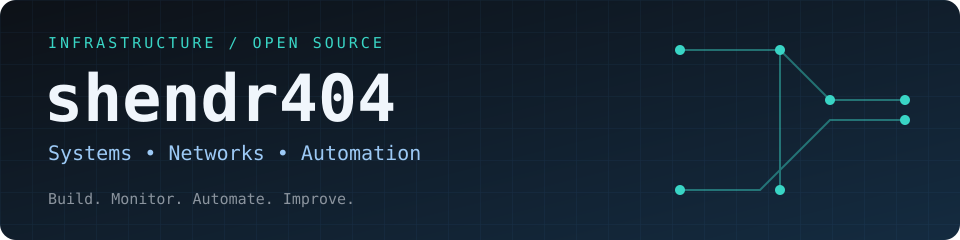
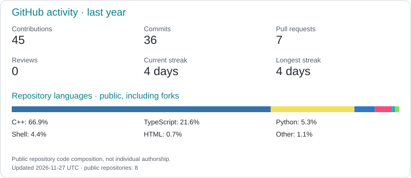

### System Administrator · Network Engineering · DevOps

## About me

I work as a system administrator with a focus on network infrastructure, Linux and Windows systems, monitoring, and automation. I enjoy turning repetitive operational tasks into reliable tools and making infrastructure easier to manage and troubleshoot.

- **Infrastructure:** servers, virtualization, containers and reverse proxies.
- **Networking:** routing, switching, VPNs, network inventory and automation.
- **Observability:** monitoring, dashboards, metrics and operational troubleshooting.
- **Communications:** VoIP, SIP, Asterisk and FreePBX.
- **Development:** Python utilities, Go, infrastructure automation and CI/CD.

## Featured projects

| Project | What it does |
| :--- | :--- |
| [**keen-pbr-sx**](https://github.com/shendr404/keen-pbr-sx) ·  | Keenetic policy-based routing with sing-box TUN, web management and per-outbound traffic metrics. Based on [keen-pbr](https://github.com/maksimkurb/keen-pbr). [Documentation](https://shendr404.github.io/keen-pbr-sx/) |
| [**cisco-auto-cdp-description**](https://github.com/shendr404/cisco-auto-cdp-description) | Automates Cisco switch interface descriptions using CDP discovery and Python. |
| [**Zabbix-KKT-ATOL-via-IP**](https://github.com/shendr404/Zabbix-KKT-ATOL-via-IP) | Zabbix integration for monitoring and remotely restarting ATOL cash registers over IP. |
| [**lockdown**](https://github.com/shendr404/lockdown) | Domain- and IP-based routing service for Keenetic. |

<b>More repositories and upstream-based projects</b>

- [phonebox_plugin](https://github.com/shendr404/phonebox_plugin) — NetBox telephone number and voice circuit management plugin.
- [ansible-role-postgres](https://github.com/shendr404/ansible-role-postgres) — PostgreSQL installation and configuration role based on Robert de Bock's work.

[Browse all public repositories](https://github.com/shendr404?tab=repositories)

## Technology stack

### Systems & virtualization

         

### Networking & communications

      

### Monitoring & observability

   

### Programming & automation

    

### DevOps & web infrastructure

       

### Data & storage

      

## Current focus

- Developing and improving sing-box routing tools for Keenetic.
- Learning Go and deepening DevOps and CI/CD skills.
- Automating network operations and infrastructure monitoring.
- Building maintainable, reproducible deployments.

## GitHub activity

<picture>
  <source media="(prefers-color-scheme: dark)" srcset="./assets/activity-dark.svg" />
  
</picture>

---

**Infrastructure should be observable, repeatable and reliable.**

